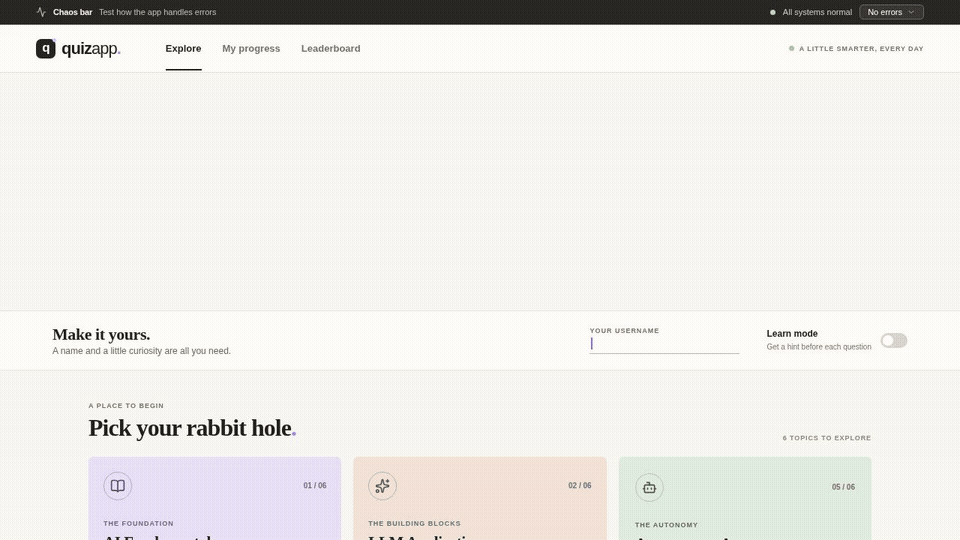

# QuizApp

QuizApp is a learning quiz for AI builders. Pick one of six topics, enter a username, and answer five multiple-choice questions. Learn Mode adds context before each answer. Results include explanations, missed questions, attempt history, and progress. The leaderboard sums correct answers across completed quizzes; Quiz and Learn modes are ranked separately. The daily challenge uses the UTC date to select the same five questions for everyone.

<p align="center">
  
  <br />
  <em>Interactive walkthrough created programmatically with <a href="https://www.remotion.dev">Remotion</a> · <a href="public/demo.mp4">View HD video (MP4)</a></em>
</p>

## Run locally

Use Node.js 24 (recommended) and npm:

```sh
npm install
npm run dev
```

Open [http://localhost:3000](http://localhost:3000). The top chaos bar can simulate failures before processing or a lost response in development. API responses intentionally take at least 500 ms. Daily challenges reset at 00:00 UTC; a session started earlier retains its original questions and date.

```sh
npm test                 # unit and component tests
npm run test:coverage    # enforce 100% coverage for app, API and components
npx playwright install chromium  # first time only
npm run test:e2e         # isolated local browser-test server on port 3233
npm run typecheck
npm run build
npm run video:render     # render Remotion demo video to public/demo.mp4
npm run video:preview    # open interactive Remotion Studio preview
```

The question bank, including answer keys, is server-side in `data/questions.json`; do not put it in `public/` or import it into client components. The API is documented by the route implementation in `app/api/[...path]/route.ts`.

## Edge cases and accepted trade-offs

| Case | Current behavior and limit |
| --- | --- |
| Server restart or multiple instances | **Partial:** an expired session is reported and local history remains, but the in-memory server loses sessions and leaderboard totals. Instances do not share state. |
| Lost responses, double clicks, and competing answers | **Handled in one server process:** pending requests and idempotency keys are saved before submission; retries reuse the payload and key. The server accepts one answer per question and rejects out-of-order answers. LocalStorage updates across tabs are not transactional. |
| Repeated completion | **Handled in one server process:** completion is a state transition; the leaderboard is derived from completed sessions and counts each session once. There is no durable database transaction. |
| Identity and tampering | **Demo only:** random session credentials are sent in authorization headers, and anonymous IDs are separate from display names. LocalStorage and client-generated IDs are untrusted; users can impersonate IDs, edit local history, or share names. |
| Cumulative leaderboard | **Handled as specified:** every completed retake contributes; attempts and accuracy are displayed, with separate Learn and Quiz rankings. More attempts can outrank higher accuracy. |
| Learn Mode and memorization | **Partial:** hints are separate from answer keys and options are shuffled, but some hints paraphrase the right answer. The 90-question bank and post-answer explanations make memorization easy. |
| Changed questions and browser storage | **Handled with limits:** sessions snapshot question content, and completed local reviews preserve missed questions. Storage failures or corrupt data are reported and can be reset; blocked storage prevents unsafe submissions. Clearing storage loses local history. |
| Chaos and uncertain outcomes | **Handled:** development-only chaos can fail before processing or simulate a lost response after processing. A pending answer stays locked until retried or reconciled; production disables chaos. |
| Daily challenge | **Handled with limits:** server-selected UTC date and question order are pinned to the session. Changing the question bank can change that day's selection for newly started sessions. Retakes count again on the leaderboard. |

## Suggested next steps

- Move sessions, idempotency records, question versions, and leaderboard totals into shared durable storage with transactional constraints; add authentication and authorization for real identities.
- Review and rewrite answer-revealing Learn Mode notes, expand the question bank, and decide whether repeated daily attempts should count in a competitive leaderboard.
- Add conflict-safe cross-tab persistence and server-side history, retention policies, rate limits, and monitoring before a public or multi-instance deployment.

## GitHub Actions: Automated PR Solver with Aider

This repository includes an automated GitHub Action workflow ([`.github/workflows/aider-solve-pr.yml`](.github/workflows/aider-solve-pr.yml)) powered by [Aider](https://aider.chat) to automatically solve and iterate on open Pull Requests.

### Capabilities
- **Auto-solve newly opened PRs**: Reads the PR title and description, checks out the PR branch, implements the requested solution, runs the test suite (`npm run typecheck && npm test`), commits changes, and pushes directly to the PR branch.
- **Solve existing open PRs**: Add the `aider` label to any open PR, or run the workflow manually via `workflow_dispatch` to process specific or all open PRs.
- **Interactive PR feedback via comments**: Leave a comment on any open PR starting with `/aider <instructions>` or `@aider <instructions>`. Aider will checkout the PR branch, address your feedback, verify tests pass, and push new commits back to the PR.
- **Automated test-and-repair loop**: Aider runs `--test-cmd "npm run typecheck && npm test" --auto-test` so all changes are automatically verified and auto-repaired before pushing.
- **Loop prevention & skip flag**: To exclude a PR from automated processing, include `[skip aider]` in the PR title or description.

### Required Setup

1. **Configure Repository Secret(s)**:
   In your GitHub repository, navigate to **Settings > Secrets and variables > Actions**, and add at least one LLM API key:
   - `ANTHROPIC_API_KEY` (default: `claude-3-7-sonnet-20250219`)
   - `OPENAI_API_KEY` (default: `gpt-4o`)
   - `GEMINI_API_KEY` (default: `gemini/gemini-2.0-flash`)
   - `DEEPSEEK_API_KEY` (default: `deepseek/deepseek-chat`)
   - `OPENROUTER_API_KEY` (default: `openrouter/anthropic/claude-3.5-sonnet`)

2. **Workflow Permissions**:
   Under **Settings > Actions > General > Workflow permissions**:
   - Select **Read and write permissions**
   - Check **Allow GitHub Actions to create and approve pull requests**

3. **Repository Configuration (`.aider.conf.yml`)**:
   Repository-level defaults for test runner, auto-commits, and agent instruction guidelines (`AGENTS.md`) are configured in [`.aider.conf.yml`](.aider.conf.yml).

